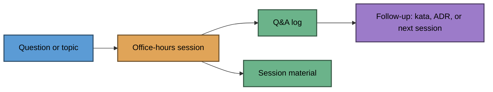

# office-hours

> Questions, answers, and session material from my software engineering office hours.

<!-- markdownlint-disable-next-line MD013 -->
      

[Getting started](#getting-started) · [How it works](#how-it-works) · [Layout](#layout) · [Progress](#progress) · [Ground rules](#ground-rules)

## Getting started

This repo keeps two things for each office-hours session:

- **Q&A log**: the questions asked, the answers given, and any follow-ups.
- **Session material**: the agenda, slides, demos, and sample code used in the session.

Swamy brings the topic for each session; Swamy and AI agree its scope and material before anything is added.
There is no code yet, so there are no build, run, or test commands. With Node.js 22+ installed, check Markdown from the repo root before committing:

```powershell
npx --yes markdownlint-cli2@0.23.3
```

## How it works



```text
Question or topic --> Office-hours session --+--> Q&A log --> Follow-up: kata, ADR, or next session
                                             |
                                             +--> Session material
```

## Layout

Proposed; created when the first session is agreed.

```text
sessions/
  <yyyy-mm-dd>-<topic>/
    notes.md      agenda, questions, answers, follow-ups
    slides/       only when the session has slides
    demos/        only when the session has demos or sample code
```

## Progress

- Done: repository created.
- Next: agree the first session's topic, scope, and material.

## Ground rules

- This repo is public. Record questions without attendee names unless they agree to be named.
- No secrets, credentials, or customer data in notes, slides, or demos.
- Demo code follows the shared rules in `AGENTS.md`, including test-first for any code.
- Follow-ups that become exercises go to the matching repo (for example `tdd-in-practice` or `clean-code-in-practice`), not here.

## Related repos

| Repo | Role |
| --- | --- |
| [architecture-learning-hub](https://github.com/Blackbaud-ViswanathaSwamyPK/architecture-learning-hub) | Index of all my architecture-learning repos |
| [tdd-in-practice](https://github.com/Blackbaud-ViswanathaSwamyPK/tdd-in-practice) | Test-driven development katas that follow-ups can become |
| [clean-code-in-practice](https://github.com/Blackbaud-ViswanathaSwamyPK/clean-code-in-practice) | Clean code exercises that follow-ups can become |
| [engineering-governance](https://github.com/Blackbaud-ViswanathaSwamyPK/engineering-governance) | Shared AI-assisted engineering standards |

## License

[MIT](LICENSE)
