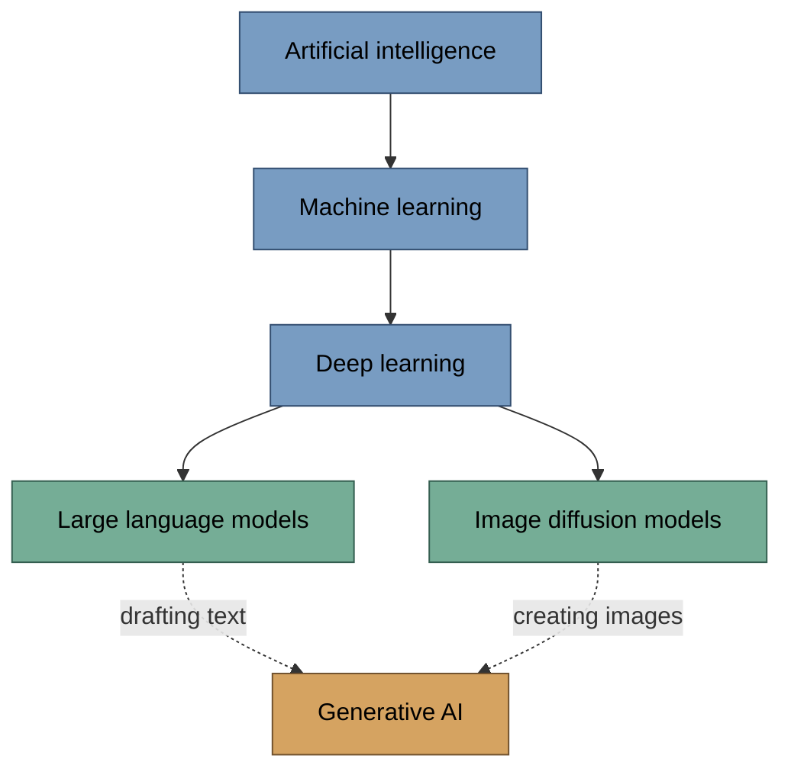

# Understanding large language models

27 November 2026 | Theory and discussion | 30 minutes

Suppose a museum moves a concert from the courtyard to the reading room.
A language model can rewrite the announcement in a warmer tone. Can it also
tell a visitor whether the reading room has step-free access? Keep those two
requests in mind: both invite fluent answers, but only one can be answered
from the announcement.

## Agenda

1. Where do LLMs fit within AI? (4 minutes)
2. What happens between a prompt and a sentence? (6 minutes)
3. What did the model learn before the conversation? (7 minutes)
4. When is a language model the right choice? (5 minutes)
5. Discuss what would make an answer trustworthy. (8 minutes)

## The big picture: where LLMs fit

Read the solid arrows from a broad field to a more specific approach.
The dotted arrows answer a different question: *what can the model do?*



```text
Artificial intelligence --> Machine learning --> Deep learning
Deep learning --> Large language models ..(drafting text)..> Generative AI
Deep learning --> Image diffusion models ..(creating images)..> Generative AI
```

Think of five questions the museum might ask:

| Topic | Museum question | What makes it an example? |
| --- | --- | --- |
| Artificial intelligence (AI) | Which route visits every open gallery before closing? | A planner can search for a route using a map and explicit rules. AI includes reasoning and planning; it need not learn from data. |
| Machine learning (ML) | How many visitors should we expect on Saturday? | A model learns patterns from past attendance rather than relying on a hand-written rule for every weekend. |
| Deep learning | Which instrument appears in this concert photo? | A neural network with many layers can learn useful visual features from photos rather than requiring a curator to specify the shape of each instrument. |
| Large language models (LLMs) | Does this notice say the concert moved or was cancelled? | An LLM is a deep network trained on large amounts of language. It can use the wording in context to assign a label or to draft a reply. |
| Generative AI (GenAI) | Can we draft a new announcement or design a concert poster? | The defining feature is creating content. An LLM can write the announcement; an image diffusion model can create artwork by progressively removing noise. |

**Discussion check:** Labeling an existing photo and creating new poster art
can both use deep learning. Only the second task asks for new content. That
is why *generative AI* and *large language model* are not interchangeable.

## Follow one sentence through the model

A language model works with **tokens**: pieces of text that might be a word,
part of a word, or punctuation. A GPT-style model represents tokens as numbers
and uses a neural network to score possible next tokens. It selects one,
appends it, and scores the next possibilities using the longer sequence.
This is **autoregressive generation**. There need not be a complete answer
waiting somewhere for the model to retrieve.

Consider the announcement: *The concert moved indoors because of rain. It
still starts at six.* To interpret *it*, a reader reaches back past *rain* to
*concert*. In a transformer, **self-attention** lets a token's representation
draw on other tokens to different degrees. In a GPT-style decoder it can draw
on earlier positions, not future ones. This gives the prediction access to
relationships beyond the nearest word. It does not give the model access to
the museum's building records.

Different transformer designs make different context available:

| Design | What context can it use? | What does that help it do? |
| --- | --- | --- |
| Encoder, as in BERT | Text on both sides of a position | Infer a hidden token or represent a whole notice for classification. |
| Decoder, as in GPT | The prompt and the continuation so far | Draft a new notice, one token at a time. |
| Encoder-decoder | An encoded source plus the output written so far | Translate a complete notice while generating the translation in order. |

## Separate learning from answering

Machine learning is one approach to AI; deep learning is the branch that
learns representations through layers of a neural network. An older text
classifier might depend on someone choosing a feature such as whether a
notice contains *cancelled*. An LLM learns many useful distinctions from
examples, including that *moved indoors* need not mean *called off*.

| Stage | What provides the learning signal? | What changes? |
| --- | --- | --- |
| Pretraining | For a GPT-style model, the actual next token in each training passage is the target. No one has to label every sentence. | Prediction errors guide updates to the model's adjustable numbers, its **parameters**. |
| Fine-tuning | A smaller set of examples targets a behavior: requests paired with good responses for instruction following, or notices paired with event-status labels for classification. | Training adjusts parameters toward the chosen behavior. |
| Inference | The visitor supplies a question and perhaps a corrected notice. No training target is required. | The context changes; ordinarily the parameters do not. |

“Large” usually describes a model with many parameters trained on a great
deal of text; tokens measure text, not model size. A broad prediction task
can yield abilities beyond that task: the same model may translate a notice,
summarize it, or draft a reply without a separate classifier for each job.
That transfer is useful, but a convincing sentence is not evidence of
human-like comprehension or factual accuracy.

## Choose what to change

If the venue changes again tomorrow, supply the current notice rather than
retraining a model to remember yesterday's room. If thousands of notices must
consistently receive one of four routing labels, fine-tuning on reviewed
examples may be worth comparing with a simpler classifier.

Building a small model from scratch can explain how tokenization, attention,
training, and generation fit together. It is a different goal from obtaining
a capable general model: pretraining at scale consumes data, compute, and
time. Reusing pretrained weights avoids repeating that initial cost. A smaller
local model may keep notices on the device and work without a network trip,
but it must fit the device, and someone must evaluate it and maintain updates.

## Discussion prompts

- **What supports the claim that the concert still starts at six?** The notice
  states it. A paraphrase can be checked against that sentence.
- **What supports an answer about step-free access?** Nothing in the notice.
  The next useful step is to consult the venue's accessibility information,
  not to ask for a more confident answer.
- **Closing question:** If a correction in the prompt changes the answer now,
  should an unrelated visitor get the correction tomorrow? Distinguish what
  was in this conversation from what changed in the model.

## Q&A and follow-ups

The questions above are for the discussion. No attendee questions, answers,
or agreed follow-ups have been recorded yet.

## Further reading

- Sebastian Raschka, [Build a Large Language Model (From Scratch)](https://www.manning.com/books/build-a-large-language-model-from-scratch), chapter 1: model foundations and the training lifecycle.
- Vaswani et al., [Attention Is All You Need](https://arxiv.org/abs/1706.03762): the original encoder-decoder transformer.
- Devlin et al., [BERT](https://arxiv.org/abs/1810.04805): bidirectional pretraining.
- Brown et al., [Language Models are Few-Shot Learners](https://arxiv.org/abs/2005.14165): task examples in context without parameter updates.
